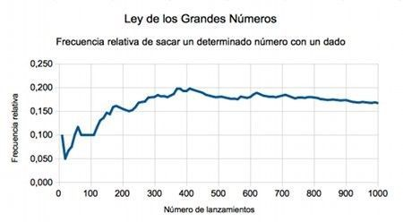
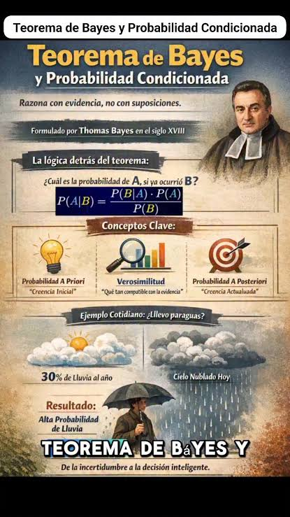

```{=html}
<div style="position:absolute; top:10px; right:10px;">

</div>
```

```{=html}
<style>
body{
  background-color:#f7f6ed;
  font-size:130%;
  text-align:justify;
}
</style>
```

# .Cargar paquetes

```{r}
ipak <- function(pkg){

  options(repos = c(CRAN="https://cloud.r-project.org"))

  new.pkg <- pkg[!(pkg %in% rownames(installed.packages()))]

  if(length(new.pkg)) install.packages(new.pkg, dependencies = TRUE)

  invisible(lapply(pkg, function(p)
    suppressPackageStartupMessages(library(p, character.only = TRUE))
  ))
}

packages <- c("tidyverse","kableExtra","psych","readxl")

ipak(packages)
```

# .Introducción

La probabilidad es una herramienta matemática que permite cuantificar la incertidumbre asociada a los resultados de un fenómeno aleatorio. En la administración pública, por ejemplo, puede utilizarse para estudiar la posibilidad de que una solicitud sea atendida dentro de un plazo, estimar la ocurrencia de fallas en un servicio, analizar la selección de beneficiarios de un programa o evaluar riesgos en la ejecución presupuestal.

En este documento se presentan los conceptos fundamentales de probabilidad, sus propiedades y teoremas principales. Cada tema incluye ejemplos contextualizados y aplicaciones reproducibles en **R**.

# .Resultados de aprendizaje

Al finalizar el estudio, el estudiante estará en capacidad de:

- Identificar experimentos aleatorios, espacios muestrales y eventos.
- Diferenciar las interpretaciones clásica, frecuentista y subjetiva de la probabilidad.
- Aplicar los axiomas y propiedades básicas de probabilidad.
- Calcular probabilidades condicionales y reconocer eventos independientes.
- Utilizar los teoremas de multiplicación y probabilidad total.
- Aplicar el teorema de Bayes para actualizar probabilidades con nueva información.
- Resolver problemas de probabilidad mediante funciones de R.

# .Experimento aleatorio

Un **experimento aleatorio** es un procedimiento o proceso cuyo resultado no puede determinarse con certeza antes de realizarlo, aunque se conozcan los posibles resultados.

Un experimento aleatorio debe cumplir, en términos generales, con estas características:

1.  Puede repetirse bajo condiciones semejantes.
2.  Se conocen los resultados posibles.
3.  No es posible anticipar con certeza cuál resultado ocurrirá en una realización particular.

**Ejemplos en administración pública:**

- Seleccionar al azar una solicitud de un conjunto de trámites y observar si fue resuelta dentro del plazo establecido.
- Elegir un ciudadano y registrar si utiliza un servicio público digital.
- Inspeccionar un contrato y determinar si presenta alguna observación.
- Seleccionar un municipio y registrar si ejecutó al menos el 90 % de su presupuesto.

**Ejemplo. Atención de solicitudes**

Una oficina pública selecciona al azar una solicitud y registra si fue atendida dentro del plazo establecido.

Los resultados posibles son:

- $C$: la solicitud fue atendida a tiempo.
- $N$: la solicitud no fue atendida a tiempo.

El resultado de una selección concreta no se conoce antes de observar el expediente, por lo que se trata de un experimento aleatorio.

# .Espacio muestral

El **espacio muestral**, representado por $\Omega$ o $S$, es el conjunto de todos los resultados posibles de un experimento aleatorio.

**Ejemplos**

**Lanzamiento de una moneda:**

$$
\Omega=\{\text{cara},\text{sello}\}
$$

**Lanzamiento de un dado:**

$$
\Omega=\{1,2,3,4,5,6\}
$$

**Evaluación de una solicitud:**

$$
\Omega=\{\text{A tiempo},\text{Fuera de plazo}\}
$$

En experimentos con varios pasos, el espacio muestral puede construirse mediante pares ordenados o productos cartesianos. Por ejemplo, al lanzar dos monedas:

$$
\Omega=\{(C,C),(C,S),(S,C),(S,S)\}
$$

**Aplicación en R: construir espacios muestrales**

```{r}
# Espacio muestral de un dado
dado <- 1:6
dado

# Espacio muestral de dos lanzamientos de moneda
moneda <- c("Cara", "Sello")
dos_lanzamientos <- expand.grid(
  primer_lanzamiento = moneda,
  segundo_lanzamiento = moneda
)
dos_lanzamientos
```

# .Suceso o evento

Un **evento** es cualquier subconjunto del espacio muestral. Se representa habitualmente con letras mayúsculas, como $A$, $B$ o $C$.

Un evento ocurre cuando el resultado observado pertenece al conjunto que lo define.

**Tipos de eventos**

- **Evento simple:** contiene un solo resultado.
- **Evento compuesto:** contiene dos o más resultados.
- **Evento seguro:** coincide con todo el espacio muestral; su probabilidad es 1.
- **Evento imposible:** no contiene resultados; su probabilidad es 0.
- **Eventos complementarios:** uno ocurre cuando el otro no ocurre.
- **Eventos mutuamente excluyentes:** no pueden ocurrir simultáneamente.

**Ejemplo. Lanzamiento de un dado**

Considere:

$$
\Omega=\{1,2,3,4,5,6\}
$$

Definimos los eventos:

- $A$: obtener un número par, $A=\{2,4,6\}$.
- $B$: obtener un número mayor que 4, $B=\{5,6\}$.
- $A^c$: no obtener un número par, $A^c=\{1,3,5\}$.

La intersección es:

$$
A\cap B=\{6\}
$$

La unión es:

$$
A\cup B=\{2,4,5,6\}
$$

**Operaciones entre eventos**

| Operación    | Notación  | Interpretación      |
|--------------|-----------|---------------------|
| Unión        | $A\cup B$ | Ocurre A, B o ambos |
| Intersección | $A\cap B$ | Ocurren A y B       |
| Complemento  | $A^c$     | No ocurre A         |
| Diferencia   | $A-B$     | Ocurre A, pero no B |

**Aplicación en R**

```{r}
S <- 1:6
A <- c(2, 4, 6)       # Número par
B <- c(5, 6)         # Número mayor que 4

union(A, B)           # A unión B
intersect(A, B)       # A intersección B
setdiff(S, A)         # Complemento de A
setdiff(A, B)         # A menos B
```

# .Concepto de probabilidad

La **probabilidad** es una medida numérica de la posibilidad de ocurrencia de un evento. Se expresa mediante un número entre 0 y 1:

$$
0\leq P(A)\leq 1
$$

Una probabilidad cercana a 0 indica poca posibilidad de ocurrencia; una cercana a 1 indica alta posibilidad.

**Enfoque clásico**

El enfoque clásico se utiliza cuando los resultados elementales son igualmente probables. La probabilidad de un evento $A$ se calcula como:

$$
P(A)=\frac{\text{Número de resultados favorables}}
{\text{Número total de resultados posibles}}
=\frac{|A|}{|\Omega|}
$$

**Ejemplo.**

Se lanza un dado equilibrado. ¿Cuál es la probabilidad de obtener un número par?

Los resultados favorables son $\{2,4,6\}$, es decir, tres resultados, de seis posibles:

$$
P(A)=\frac{3}{6}=0.5
$$

Por tanto, la probabilidad es del 50 %.

```{r}
favorables <- 3
posibles <- 6
p_par <- favorables / posibles
p_par
```

**Enfoque frecuentista**

El enfoque frecuentista interpreta la probabilidad como el límite de la frecuencia relativa de ocurrencia de un evento cuando el experimento se repite un número muy grande de veces, bajo condiciones comparables.

Para un número finito de repeticiones se estima mediante:

$$
\widehat{P}(A)=\frac{f_A}{n}
$$

Donde:

- $f_A$: número de veces que ocurre el evento.
- $n$: número total de repeticiones.

**Ejemplo.**

En una oficina se revisan 200 solicitudes y se encuentra que 150 fueron atendidas dentro del plazo. La probabilidad frecuentista estimada de atención oportuna es:

$$
\widehat{P}(A)=\frac{150}{200}=0.75
$$

La estimación es del 75 %. Es una estimación basada en datos observados, no una garantía de que el mismo porcentaje se mantenga en el futuro.

```{r}
solicitudes <- 200
atendidas_tiempo <- 150

prob_frecuentista <- atendidas_tiempo / solicitudes
prob_frecuentista
```

**Simulación frecuentista con R**

```{r}
set.seed(2026)

n <- 10000
lanzamientos <- sample(
  c("Cara", "Sello"),
  size = n,
  replace = TRUE
)

frecuencia_relativa <- cumsum(lanzamientos == "Cara") / seq_len(n)

plot(
  frecuencia_relativa,
  type = "l",
  xlab = "Número de lanzamientos",
  ylab = "Frecuencia relativa de cara",
  main = "Convergencia de la frecuencia relativa"
)
abline(h = 0.5, lty = 2, lwd = 2)
```

**Simulación frecuentista con Shiny Web**

::: callout-note
## Dar clic sobre la gráfica
:::

[{fig-align="center"}](https://dago670826.shinyapps.io/LGN2/)

La gráfica muestra cómo la frecuencia relativa tiende a estabilizarse alrededor de 0.5 a medida que aumenta el número de lanzamientos. En una simulación finita no se espera una convergencia perfectamente monótona.

**Enfoque subjetivo**

El enfoque subjetivo considera la probabilidad como una valoración razonada de la incertidumbre, basada en la información disponible, la experiencia, el juicio experto y las circunstancias del problema.

**Ejemplo.**

Un equipo técnico estima que existe una probabilidad de 0.70 de que un proyecto público finalice en la fecha prevista, teniendo en cuenta el avance de obra, la disponibilidad presupuestal y los riesgos identificados.

Este valor no proviene necesariamente de resultados igualmente probables ni de una frecuencia histórica. Es una evaluación informada que puede actualizarse cuando aparece nueva evidencia.

**Comparación de los enfoques**

| Enfoque | Fundamento | Ejemplo |
|------------------------|------------------------|------------------------|
| Clásico | Resultados igualmente probables | Lanzamiento de un dado equilibrado |
| Frecuentista | Frecuencia relativa observada o límite de frecuencias | Proporción histórica de trámites oportunos |
| Subjetivo | Información y juicio razonado | Evaluación experta del riesgo de retraso |

# .Axiomas de probabilidad

La teoría moderna de probabilidad se fundamenta en tres axiomas, que establecen las reglas básicas para asignar probabilidades.

**Axioma 1. No negatividad**

La probabilidad de cualquier evento es mayor o igual que cero:

$$
P(A)\geq 0
$$

**Axioma 2. Normalización**

La probabilidad del espacio muestral completo es igual a uno:

$$
P(\Omega)=1
$$

**Axioma 3. Aditividad para eventos mutuamente excluyentes**

Si $A$ y $B$ son eventos mutuamente excluyentes, entonces:

$$
P(A\cup B)=P(A)+P(B)
$$

Para una colección numerable de eventos mutuamente excluyentes, la probabilidad de la unión es la suma de sus probabilidades.

**Propiedades derivadas**

**Probabilidad del evento imposible:**

$$
P(\varnothing)=0
$$

**Regla del complemento:**

$$
P(A^c)=1-P(A)
$$

**Regla general de la suma:**

$$
P(A\cup B)=P(A)+P(B)-P(A\cap B)
$$

**Monotonicidad:**

si $A\subseteq B$, entonces:

$$
P(A)\leq P(B)
$$

**Ejemplo. Clasificación de solicitudes**

En una dependencia pública, la probabilidad de que una solicitud sea clasificada como de prioridad alta es 0.25. La probabilidad de que sea de prioridad media es 0.45. Si ambas categorías son mutuamente excluyentes, la probabilidad de que sea alta o media es:

$$
P(A\cup M)=0.25+0.45=0.70
$$

La probabilidad de que no sea de prioridad alta es:

$$
P(A^c)=1-0.25=0.75
$$

```{r}
p_alta <- 0.25
p_media <- 0.45

p_alta_o_media <- p_alta + p_media
p_no_alta <- 1 - p_alta

p_alta_o_media
p_no_alta
```

# .Probabilidad condicional

La **probabilidad condicional** mide la probabilidad de que ocurra un evento $A$, sabiendo que ya ocurrió otro evento $B$. Se representa como $P(A\mid B)$.

Siempre que $P(B)>0$, se define como:

$$
P(A\mid B)=\frac{P(A\cap B)}{P(B)}
$$

La información de que ocurrió $B$ modifica el conjunto de referencia sobre el cual se calcula la probabilidad.

<LearningViz type_id="CONDITIONAL_PROBABILITY_DEFINITION" locale_override="es-419" />

**Ejemplo. Uso de servicios digitales**

En una encuesta a 500 ciudadanos se registró la siguiente información:

|           | Realizó trámite digital | No realizó trámite digital |   Total |
|-----------|------------------------:|---------------------------:|--------:|
| Jóvenes   |                     180 |                         70 |     250 |
| Adultos   |                     100 |                        150 |     250 |
| **Total** |                 **280** |                    **220** | **500** |

Sea:

- $J$: seleccionar un ciudadano joven.
- $D$: seleccionar un ciudadano que realizó un trámite digital.

La probabilidad de que un ciudadano haya realizado un trámite digital, dado que es joven, es:

$$
P(D\mid J)=\frac{P(D\cap J)}{P(J)}
=\frac{180}{250}=0.72
$$

La probabilidad es del 72 %.

En cambio, la probabilidad de que sea joven, dado que realizó un trámite digital, es:

$$
P(J\mid D)=\frac{180}{280}\approx 0.6429
$$

Las dos probabilidades condicionales no son iguales: el evento que aparece después de la barra vertical define la condición.

**Aplicación en R**

```{r}
tabla <- matrix(
  c(180, 70,
    100, 150),
  nrow = 2,
  byrow = TRUE,
  dimnames = list(
    Grupo = c("Joven", "Adulto"),
    Tramite = c("Digital", "No digital")
  )
)

tabla

# P(Digital | Joven)
p_dado_joven <- tabla["Joven", "Digital"] / sum(tabla["Joven", ])
p_dado_joven

# P(Joven | Digital)
p_joven_dado_digital <- tabla["Joven", "Digital"] / sum(tabla[, "Digital"])
p_joven_dado_digital

# Proporciones por fila
prop.table(tabla, margin = 1)

# Proporciones por columna
prop.table(tabla, margin = 2)
```

# .Independencia de eventos

Dos eventos $A$ y $B$ son **independientes** cuando la ocurrencia de uno no modifica la probabilidad de ocurrencia del otro.

La condición matemática es:

$$
P(A\cap B)=P(A)P(B)
$$

Si $P(B)>0$, una condición equivalente es:

$$
P(A\mid B)=P(A)
$$

**Importante:**

independencia y exclusión mutua son conceptos diferentes. Si dos eventos son mutuamente excluyentes y ambos tienen probabilidad positiva, no pueden ser independientes.

**Ejemplo. Dos selecciones independientes**

Suponga que se realizan dos sorteos independientes, cada uno con probabilidad 0.4 de seleccionar una solicitud prioritaria.

Sea $A$: el primer sorteo selecciona una solicitud prioritaria.

Sea $B$: el segundo sorteo selecciona una solicitud prioritaria.

Entonces:

$$
P(A\cap B)=0.4(0.4)=0.16
$$

La probabilidad de que ambos sorteos seleccionen solicitudes prioritarias es 0.16.

```{r}
p_A <- 0.4
p_B <- 0.4

p_A_inter_B <- p_A * p_B
p_A_inter_B
```

**Verificación de independencia con datos**

```{r}
p_A_obs <- 0.30
p_B_obs <- 0.50
p_inter_obs <- 0.15

# Si se cumple esta igualdad, los eventos son independientes
independientes <- isTRUE(
  all.equal(p_inter_obs, p_A_obs * p_B_obs)
)

independientes
```

En datos reales, las probabilidades observadas son estimaciones. Por ello, una igualdad aproximada no demuestra por sí sola independencia en la población.

# .Teorema de la multiplicación

El teorema de la multiplicación permite calcular la probabilidad de que dos eventos ocurran simultáneamente:

$$
P(A\cap B)=P(A)P(B\mid A)
$$

También puede escribirse como:

$$
P(A\cap B)=P(B)P(A\mid B)
$$

Si los eventos son independientes, se simplifica a:

$$
P(A\cap B)=P(A)P(B)
$$

**Ejemplo. Revisión de expedientes**

Una entidad pública tiene expedientes de los cuales el 30 % presenta documentación incompleta. Entre los expedientes incompletos, el 20 % presenta además errores de identificación.

Definimos:

- $I$: expediente con documentación incompleta.
- $E$: expediente con error de identificación.

Se conoce:

$$
P(I)=0.30,\qquad P(E\mid I)=0.20
$$

La probabilidad de que un expediente presente ambas características es:

$$
P(I\cap E)=0.30(0.20)=0.06
$$

Por tanto, el 6 % de los expedientes presenta simultáneamente documentación incompleta y errores de identificación.

```{r}
p_incompleto <- 0.30
p_error_dado_incompleto <- 0.20

p_ambos <- p_incompleto * p_error_dado_incompleto
p_ambos
```

**Aplicación: selección sin reemplazo**

Una oficina tiene 10 expedientes: 4 incompletos y 6 completos. Se seleccionan dos expedientes consecutivamente, sin devolver el primero. ¿Cuál es la probabilidad de que ambos sean incompletos?

$$
P(I_1\cap I_2)=\frac{4}{10}\frac{3}{9}
=\frac{2}{15}\approx 0.1333
$$

```{r}
p_dos_incompletos <- (4 / 10) * (3 / 9)
p_dos_incompletos
```

La segunda probabilidad condicional cambia porque el primer expediente no se devuelve. Por tanto, las selecciones no son independientes.

# .Teorema de la probabilidad total

El **teorema de la probabilidad total** permite calcular la probabilidad de un evento a partir de una partición del espacio muestral.

Suponga que $B_1,B_2,\ldots,B_k$ son eventos mutuamente excluyentes, exhaustivos y con probabilidades positivas. Para cualquier evento $A$:

$$
P(A)=\sum_{i=1}^{k}P(A\mid B_i)P(B_i)
$$

Es decir:

$$
P(A)=P(A\mid B_1)P(B_1)+\cdots+
P(A\mid B_k)P(B_k)
$$

**Ejemplo. Solicitudes por dependencia**

Una alcaldía recibe solicitudes de tres dependencias:

- Dependencia A: recibe el 40 % de las solicitudes; el 5 % presenta errores.
- Dependencia B: recibe el 35 % de las solicitudes; el 8 % presenta errores.
- Dependencia C: recibe el 25 % de las solicitudes; el 10 % presenta errores.

Sea $E$ el evento de que una solicitud presente errores. Se desea calcular la probabilidad total de que una solicitud seleccionada al azar tenga errores.

Datos:

$$
\begin{aligned}
P(A)&=0.40 & P(E\mid A)&=0.05\\
P(B)&=0.35 & P(E\mid B)&=0.08\\
P(C)&=0.25 & P(E\mid C)&=0.10
\end{aligned}
$$

Aplicando el teorema:

$$
\begin{aligned}
P(E)&=P(E\mid A)P(A)+P(E\mid B)P(B)\\
&\quad+P(E\mid C)P(C)\\
&=(0.05)(0.40)+(0.08)(0.35)+(0.10)(0.25)\\
&=0.068
\end{aligned}
$$

La probabilidad total de error es 0.068, es decir, 6.8 %.

**Aplicación en R**

```{r}
dependencia <- c("A", "B", "C")
peso <- c(0.40, 0.35, 0.25)
prob_error <- c(0.05, 0.08, 0.10)

resultado <- sum(peso * prob_error)
resultado

data.frame(
  Dependencia = dependencia,
  Proporcion_solicitudes = peso,
  Probabilidad_error = prob_error,
  Aporte_probabilidad = peso * prob_error
)
```

**Simulación del ejemplo**

```{r}
set.seed(2026)

n <- 100000

dependencias <- sample(
  dependencia,
  size = n,
  replace = TRUE,
  prob = peso
)

probabilidades_por_grupo <- setNames(prob_error, dependencia)

errores <- rbinom(
  n,
  size = 1,
  prob = probabilidades_por_grupo[dependencias]
)

mean(errores)
```

La proporción simulada debe aproximarse a 0.068 cuando el número de observaciones es suficientemente grande. Puede presentar pequeñas diferencias por variabilidad aleatoria.

# .Teorema de Bayes

El **teorema de Bayes** permite actualizar la probabilidad de un evento cuando se obtiene nueva información. Relaciona una probabilidad condicional inversa con la probabilidad inicial y la evidencia observada.

Para dos eventos $A$ y $B$, con $P(B)>0$:

<LearningViz type_id="BAYES_THEOREM" locale_override="es-419" />

Donde:

- $P(A)$: probabilidad inicial o *a priori*.
- $P(B\mid A)$: probabilidad de observar la evidencia $B$ cuando ocurre $A$.
- $P(B)$: probabilidad total de la evidencia.
- $P(A\mid B)$: probabilidad actualizada o *a posteriori*.

**Ejemplo. Detección de irregularidades**

Una entidad realiza una revisión preliminar para identificar posibles irregularidades en contratos.

Se estima que:

- El 10 % de los contratos presenta irregularidades.
- El procedimiento de revisión identifica correctamente el 90 % de los contratos irregulares.
- El procedimiento señala equivocadamente como irregular el 5 % de los contratos que no tienen irregularidades.

Definimos:

- $I$: el contrato presenta irregularidad.
- $+$: el procedimiento emite una alerta positiva.

Los datos son:

$$
P(I)=0.10
$$

$$
P(+\mid I)=0.90
$$

$$
P(+\mid I^c)=0.05
$$

Primero calculamos la probabilidad total de una alerta positiva:

$$
P(+)=P(+\mid I)P(I)+P(+\mid I^c)P(I^c)
$$

$$
P(+)=(0.90)(0.10)+(0.05)(0.90)=0.135
$$

Ahora aplicamos Bayes:

$$
P(I\mid +)=
\frac{P(+\mid I)P(I)}{P(+)}
$$

$$
P(I\mid +)=\frac{(0.90)(0.10)}{0.135}
=0.6667
$$

La probabilidad de que un contrato tenga irregularidades, dado que el procedimiento emitió una alerta positiva, es aproximadamente 66.67 %.

**Interpretación:** una alerta positiva no significa que exista certeza de irregularidad. La probabilidad posterior depende también de la frecuencia inicial de irregularidades y de los falsos positivos. Una alerta debe conducir a una revisión adecuada y no, por sí sola, a una conclusión sancionatoria.

**Aplicación en R**

```{r}
# Probabilidades iniciales
p_irregular <- 0.10
p_regular <- 1 - p_irregular

# Desempeño del procedimiento
p_positivo_dado_irregular <- 0.90
p_positivo_dado_regular <- 0.05

# Probabilidad total de alerta positiva
p_positivo <- (
  p_positivo_dado_irregular * p_irregular +
  p_positivo_dado_regular * p_regular
)

# Teorema de Bayes
p_irregular_dado_positivo <- (
  p_positivo_dado_irregular * p_irregular
) / p_positivo

p_positivo
p_irregular_dado_positivo
```

**Análisis de sensibilidad**

La probabilidad posterior cambia cuando cambia la prevalencia inicial de irregularidades. El siguiente código muestra ese comportamiento:

```{r}
prevalencia <- seq(0.01, 0.50, by = 0.01)

posterior <- (
  p_positivo_dado_irregular * prevalencia
) / (
  p_positivo_dado_irregular * prevalencia +
  p_positivo_dado_regular * (1 - prevalencia)
)

plot(
  prevalencia,
  posterior,
  type = "l",
  lwd = 2,
  xlab = "Proporción inicial de contratos irregulares",
  ylab = "Probabilidad posterior de irregularidad",
  main = "Actualización bayesiana"
)
abline(a = 0, b = 1, lty = 2)
```

**Shiny web teorema de Bayes**

::: callout-note
## Dar clic sobre la figura
:::

[{fig-align="center"}](https://connect.posit.cloud/dasaho2/content/01a1c78f-de13-aa6b-7057-6ed17437cbc4?utm_source=rsconnect-rstudio)

# .Resumen de fórmulas fundamentales

| Concepto | Fórmula |
|------------------------------------|------------------------------------|
| Probabilidad clásica | $P(A)=\frac{|A|}{|\Omega|}$ |
| Frecuencia relativa | $\widehat{P}(A)=\frac{f_A}{n}$ |
| Complemento | $P(A^c)=1-P(A)$ |
| Unión de dos eventos | $P(A\cup B)=P(A)+P(B)-P(A\cap B)$ |
| Probabilidad condicional | $P(A\mid B)=\frac{P(A\cap B)}{P(B)}$ |
| Independencia | $P(A\cap B)=P(A)P(B)$ |
| Multiplicación | $P(A\cap B)=P(A)P(B\mid A)$ |
| Probabilidad total | $P(A)=\sum_i P(A\mid B_i)P(B_i)$ |
| Bayes | $P(B_j\mid A)=\frac{P(A\mid B_j)P(B_j)}{\sum_iP(A\mid B_i)P(B_i)}$ |

# .Taller de aplicación

Resuelva los siguientes ejercicios. En cada caso, identifique los eventos, formule las probabilidades y desarrolle la solución matemática. Cuando corresponda, compruebe los resultados mediante R.

## Ejercicio 1. Espacio muestral y eventos

Una oficina de atención al ciudadano selecciona al azar una de seis solicitudes, identificadas con los números 1 a 6.

1.  Escriba el espacio muestral.
2.  Defina el evento $A$: seleccionar una solicitud con número par.
3.  Defina el evento $B$: seleccionar una solicitud con número mayor que 3.
4.  Determine $A\cup B$, $A\cap B$ y $A^c$.
5.  Calcule las probabilidades de los eventos anteriores, suponiendo que todas las solicitudes tienen la misma posibilidad de selección.

## Ejercicio 2. Probabilidad clásica

En un programa municipal se seleccionan al azar 5 expedientes de un conjunto de 20. ¿Cuál es la probabilidad de que un expediente seleccionado al azar corresponda a una de las 8 solicitudes de mejoramiento de vivienda?

Calcule también la probabilidad de que no corresponda a esa categoría.

## Ejercicio 3. Probabilidad frecuentista

Durante un mes, una dependencia recibió 800 solicitudes, de las cuales 680 fueron atendidas dentro del plazo establecido.

1.  Estime la probabilidad frecuentista de atención oportuna.
2.  Estime la probabilidad de incumplimiento del plazo.
3.  Represente los resultados mediante un gráfico de barras en R.

## Ejercicio 4. Probabilidad condicional

En una encuesta a 600 ciudadanos, 360 utilizan servicios digitales. De estos últimos, 240 manifiestan estar satisfechos. Entre los 240 ciudadanos que no utilizan servicios digitales, 120 están satisfechos.

1.  Calcule la probabilidad de satisfacción.
2.  Calcule la probabilidad de utilizar servicios digitales dado que el ciudadano está satisfecho.
3.  Calcule la probabilidad de satisfacción dado que utiliza servicios digitales.
4.  Interprete las diferencias entre las probabilidades condicionales.

## Ejercicio 5. Teorema de Bayes

Una entidad pública recibe solicitudes de tres dependencias. La dependencia A aporta el 50 % de las solicitudes, B el 30 % y C el 20 %. Las proporciones de solicitudes con errores son 4 %, 7 % y 10 %, respectivamente.

1.  Calcule la probabilidad total de seleccionar una solicitud con errores.
2.  Si una solicitud presenta errores, calcule la probabilidad de que provenga de la dependencia C.
3.  Desarrolle la solución mediante el teorema de Bayes y compruebe el resultado en R.

# .Respuestas

Estas respuestas permiten verificar los resultados numéricos principales.

- **Ejercicio 1:**

$A=\{2,4,6\}$, $B=\{4,5,6\}$, $A\cup B=\{2,4,5,6\}$, $A\cap B=\{4,6\}$, $A^c=\{1,3,5\}$. Las probabilidades son $4/6$, $2/6$ y $3/6$, respectivamente, para unión, intersección y complemento.

- **Ejercicio 2:**

$P(A)=8/20=0.40$; $P(A^c)=0.60$.

- **Ejercicio 3:**

atención oportuna $=680/800=0.85$; incumplimiento $=0.15$.

- **Ejercicio 4:**

satisfacción $=(240+120)/600=0.60$; $P(\text{digital}\mid\text{satisfecho})=240/360=0.6667$; $P(\text{satisfecho}\mid\text{digital})=240/360=0.6667$. En este ejercicio ambos denominadores coinciden por los datos propuestos.

- **Ejercicio 5:**

$P(E)=0.50(0.04)+0.30(0.07)+0.20(0.10)=0.063$. $P(C\mid E)=0.20(0.10)/0.063\approx0.3175$, es decir, 31.75 %.

# .Conclusiones

La probabilidad constituye una base esencial para el análisis de datos y la toma de decisiones en contextos de incertidumbre. Sus conceptos permiten describir resultados aleatorios, cuantificar riesgos, evaluar información y construir modelos para apoyar decisiones públicas.

La probabilidad condicional, los teoremas de multiplicación y probabilidad total, y el teorema de Bayes son especialmente importantes para analizar situaciones en las que la información disponible modifica la evaluación de un evento. R facilita estos cálculos, permite simular experimentos y ayuda a comunicar resultados mediante tablas y gráficos.

# .Referencias bibliográficas

- Devore, J. L. (2016). *Probability and Statistics for Engineering and the Sciences* (9th ed.). Cengage Learning.
- Ross, S. M. (2014). *Introduction to Probability Models* (11th ed.). Academic Press.
- Triola, M. F. (2018). *Elementary Statistics* (13th ed.). Pearson.
- R Core Team. (2026). *R: A Language and Environment for Statistical Computing*. R Foundation for Statistical Computing. https://www.R-project.org/
